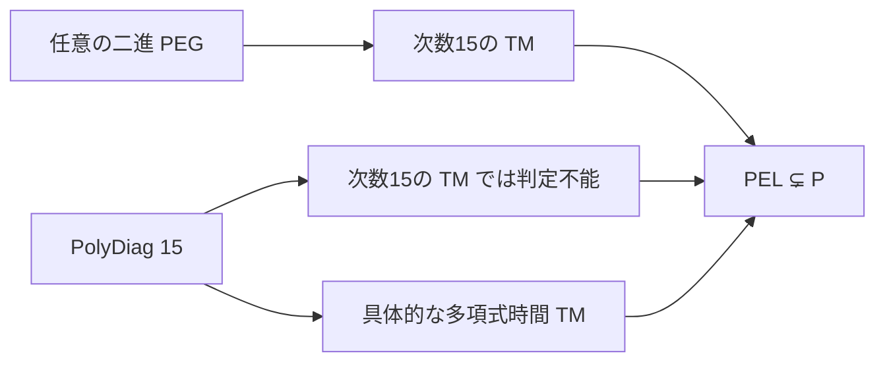

# 固定二進アルファベット上で PEL ⊊ P

`Shallot.PegSeparation.pel_strict_in_p` は、固定アルファベット `{'0', '1'}` 上の PEG 言語が
多項式時間で判定できる言語の真部分クラスであることを Lean で証明する。
時間階層による既知の分離の形式化であり、新しい分離問題の提案ではない。

## 定義の対応

- `IsBitPEL L` は、ある普通の PEG 文法 `g` が、ビットを `'0'` / `'1'` に写した入力を
  全部消費して成功することと `L` が一致すること。マクロはなく、文法の停止性や
  整形式性を仮定しない。
- `isBitPEL_iff_restriction` は、このクラスが既存の文字列版 `Cfg.IsPEL` の二進入力への
  制限と正確に同じことを示す。別のパーサ意味論を定義して代用してはいない。
- `KEXP 0` は既存の `Complexity.TM` によるクラス。`tower 0 n = n` なので、
  有限本のテープを持つ TM が `c * (入力長 + 1)^d` 以内で判定すること、すなわち P。

最終定理は包含と反例を両方与える。

```lean
(∀ L, IsBitPEL L → KEXP 0 L) ∧ ∃ L, KEXP 0 L ∧ ¬ IsBitPEL L
```

反例は具体的に `PolyDiag 15`。

## PEG 側の上界

[有限表の認識機械](peg-packrat.md) が、実入力の読み出し、未知の全表の初期化、
全構文のセル計算、末尾までの全行走査、次行の旧行への転送、有限回の反復、
開始規則の結果の読み出し、受理・拒否での停止をつなぐ。
`program_halts` は準備済みの表や実行を前提にしない。

`bitLanguage_time15` は任意の固定文法について、具体的な多テープ TM が
`c * (入力長 + 1)^15` 以内で正しい答えを出すことを示す。
係数 `c` は文法に依存してよいが、次数15は全文法に共通。
この共通の次数を分離に使う。

## 対角線

`PolyDiag p` の入力 `w` を、既存の単項符号で
`[k, nq, na, c, d] ++ encRows rows` と読む。行の長さが `2k+1` の倍数でなければ拒否。
正しく読めたら、読み出した機械の表を **元の入力 `w` 全体** 上で
`(w.length + 1)^(p + 1)` ステップだけ走らせ、状態が受理状態0でない場合に受理する。
入力中の `c` と `d` はシミュレーション回数には使わない。

次数 `p` の判定機械 `M` と任意の係数 `c` に対し、自己入力を `diagCode M c p` とする。
係数は単項で符号化されるため `c ≤ 入力長`。
したがって `M` の停止期限 `c * (入力長 + 1)^p` は対角線の固定予算以内に収まる。
自己入力での `M` の答えと対角言語の答えが反対になり矛盾する。

- `polyDiag_code`：自己入力で元の機械の実行と一致。
- `polyDiag_not_time p`：任意の係数・任意のテープ数でも次数 `p` の判定機械はない。
- `polyDiag_not_peg`：PEG 側の共通次数15と組み合わせて `PolyDiag 15` の PEG を排除。

## 対角言語の判定器も具体化する

`polyFrontP p` は既存の検証済みパーサと表・テープの配置を使い、予算を計算する前に
入力の係数を1、指数を固定の `p + 1` へ上書きする。
入力された巨大な指数をそのまま計算する経路はない。
シミュレーションに渡すテープには、ヘッダを除去した残りではなく元の入力全体を置く。

`polyDiagP p` はこの前処理、既存の `simP`、受理状態0と反対に答える処理をつなぐ。
`polyDiagP_halts` は `nInit` から全入力で停止する具体的な実行を与える。
正しいコード、不足したヘッダ、壊れた行の長さをそれぞれ証明している。
`polyDiagBound_poly` は固定した `p` に対する上限が多項式であることを示す。

`nprog_in_P` はスタック時間から空間を抑え、既存の検証済みスタック・リスト・TM の
変換を適用する。`polyDiag_in_P` は実際の多項式時間 TM の存在を結論する。
時間階層や分離の核心を、証明のない仮定として受け取る部分はない。



## 元の文字列言語クラスへの反例

`liftBinary (PolyDiag 15)` は二進文字列を受け付け、それ以外の文字を含む語を拒否する。
`lifted_polyDiag_not_PEL` はこの言語が元の `Cfg.IsPEL` に属さないこと。
`character_counterexample` は二進文字だけの語からなること、二進符号化での P 所属、
`Cfg.IsPEL` 非所属をまとめる。任意の文字列をビット列と同一視してはいない。

## 検証

主要な分離定理と構成の依存を `lean/Audit.lean` のメッセージ検査で固定する。
使うのは `propext` / `Classical.choice` / `Quot.sound` のみ。
`isBitPEL_iff_restriction` は追加の依存を持たない。
`Examples.lean` は空ヘッダ、入力に大きな指数があっても壊れた行を拒否すること、
ゼロテープの小さな表での受理・拒否の反転、二進以外の文字を含む語の排除を検証する。

```sh
cd lean
lake build
../scripts/audit-source.sh
```
